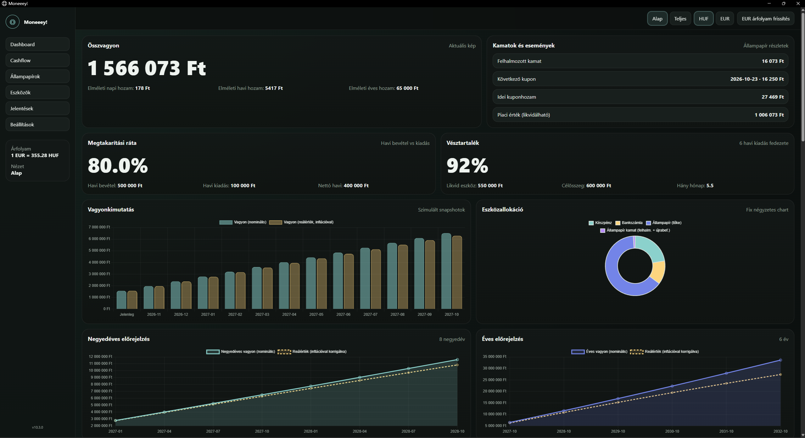
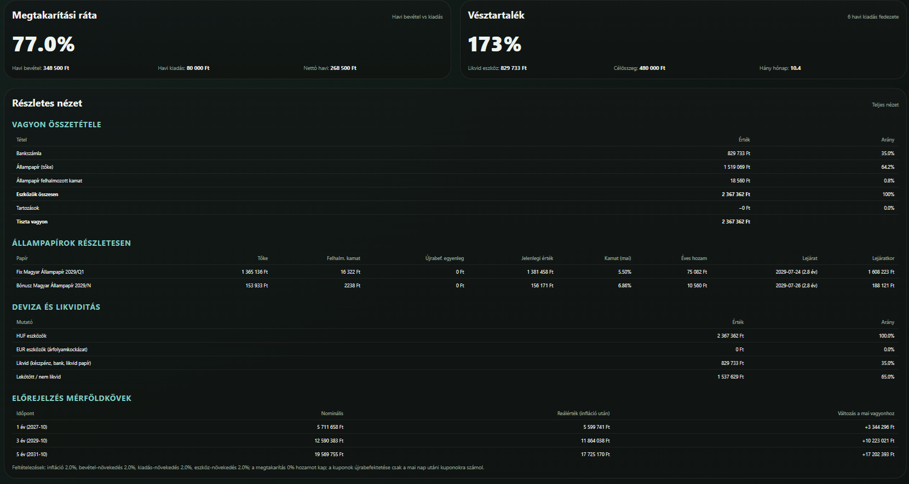
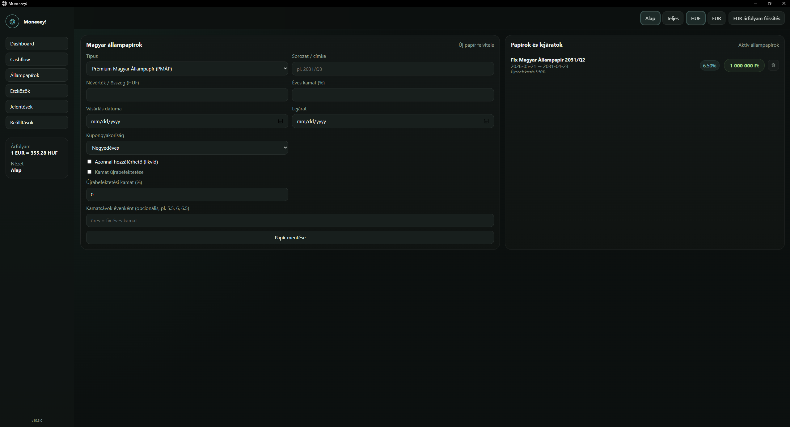
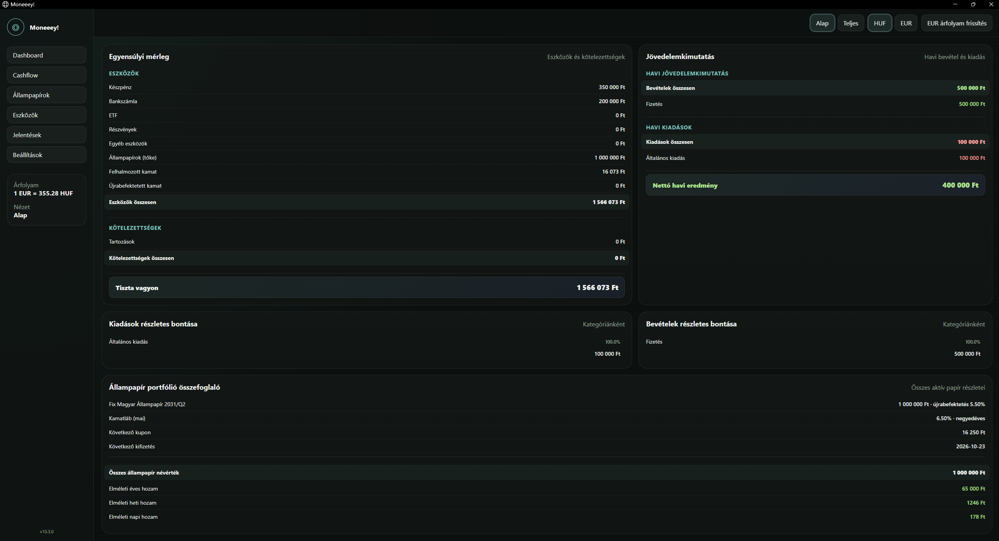
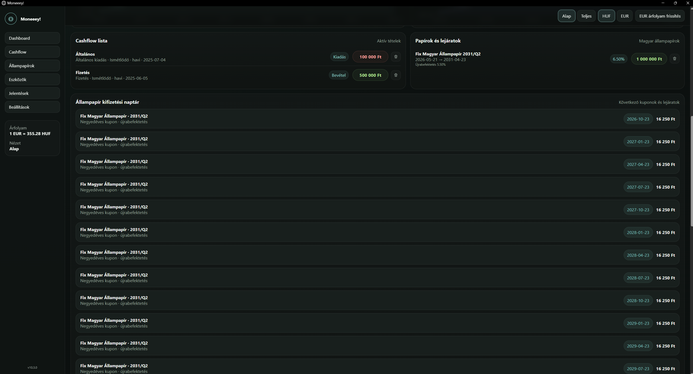

# Moneeey

Offline személyes pénzügyi tervező TypeScript, Bun és SQLite alapokon. Egy helyen követi a vagyont, a bevételeket és kiadásokat, a magyar állampapírokat, a részvényeket, ETF-eket és a kuponkifizetéseket, majd inflációval korrigált előrejelzést készít.

Az alkalmazás egyetlen helyi futtatható fájlként is csomagolható. Az adatok a saját gépen, SQLite-adatbázisban maradnak.







## Funkciók

### Dashboard (Vagyon chartok)

- **Összvagyon** és elméleti napi, havi, éves hozam.
- **Kamatok és események**: felhalmozott kamat, következő kupon és dátuma, idei kuponhozam.
- **Megtakarítási ráta**: havi bevétel és kiadás alapján, beállítható célértékkel (alapértelmezés: 20%).
- **Vésztartalék**: likvid eszközök, célösszeg (6 havi kiadás) és fedezett hónapok száma.
- **Vagyonkimutatás**: szimulált havi állapotok, nominális és inflációval korrigált értékkel.
- **Eszközallokáció**: bankszámla, állampapír tőke, állampapír kamat (felhalmozott és újrabefektetett).
- **Negyedéves előrejelzés** (8 negyedév) és **éves előrejelzés** (6 év).
- Nézetek: **Alap** és **Teljes**. Pénznem: **HUF** és **EUR**, frissíthető EUR-árfolyammal.

### Cashflow

- Bevételek és kiadások felvitele kategóriával, megnevezéssel, összeggel (HUF) és kezdő dátummal.
- Ismétlődés: havi, negyedéves vagy éves.
- Aktív tételek listája, kategóriánkénti havi bontás, megtakarítási ráta és havi összesítés.

### Állampapírok

- Támogatott típusok: Prémium Magyar Állampapír (PMP), Bónusz Magyar Állampapír, Fix Magyar Állampapír és MÁP Plusz.
- Adatok: sorozatcímke, névérték, éves kamat, vásárlás dátuma, lejárat.
- Kamatsávok évenként, például `5.5, 6, 6.5`.
- Kupongyakoriság: havonta, negyedévente, félévente, évente vagy lejáratkor.
- Kamat újrabefektetése: azonnal hozzáférhető likvid, vagy újrabefektetési kamattal.
- Kifizetési naptár a következő kuponokkal és lejáratokkal.
- Portfólió-összefoglaló: névérték, aktuális kamatláb, következő kupon és kifizetési dátum, éves hozam.

### Eszközök és mérleg

- Kategóriák: készpénz, bankszámla, ETF, részvény, egyéb eszköz, tartozás.
- Pénznem: HUF vagy EUR.
- Egyensúlyi mérleg: eszközök, kötelezettségek és tiszta vagyon.
- Jövedelemkimutatás: havi bevétel, kiadás, nettó eredmény, részletes bontás.

### Beállítások

- EUR/HUF árfolyam.
- Bevétel-, kiadás- és eszköznövekedés.
- Éves infláció.
- Adó az állampapírok kamatán.

## Technológia

| Réteg            | Megoldás                                 |
| ---------------- | ---------------------------------------- |
| Nyelv            | TypeScript                               |
| Futtatókörnyezet | Bun                                      |
| Adatbázis        | SQLite (`finance.db`)                    |
| Szerver          | `src/server.ts`                          |
| Frontend         | statikus fájlok a `public` mappában      |
| Csomagolás       | `bun build --compile` önálló Windows exe |

## Gyors kezdés

Futtatható alkalmazás letöltése `moneeey-*_x64.zip` a [**Releases**](../../releases) oldalról, tömörítsd ki és futtasd a `moneeey.exe`-t.

vagy forrásból

Előfeltétel: Windows és [Bun](https://bun.sh).

```bat
winget install Oven-sh.Bun
bun install
bun run src/server.ts
```

Ha a `package.json` tartalmaz saját indító scriptet, azt használd. A szerver portját és címét a `src/server.ts` határozza meg.

## Build (Windows)

```bat
winget install Oven-sh.Bun
bun install
mkdir dist\data
copy finance.db dist\data\finance.db
xcopy /E /I public dist\public
bun build --compile --minify --windows-hide-console src/server.ts --outfile dist/moneeey.exe
```

Eredmény:

```text
dist/
├── moneeey.exe
├── data/
│   └── finance.db
└── public/
```

Futtatás:

```bat
cd dist
moneeey.exe
```

- A `--windows-hide-console` miatt nem nyílik konzolablak.
- A `dist` mappát egységként másold vagy terjeszd. Az exe nem működik a `data` és `public` mappák nélkül.
- A build a gyökérben lévő `finance.db`-t másolja. Nyilvános megosztás előtt cseréld anonim vagy üres adatbázisra.

## Számítások

A képletek a felületen látható mutatók értelmezését írják le. A pontos kerekítés és dátumkezelés a forráskódban van.

```text
Nettó vagyon        = Eszközök − Kötelezettségek
Nettó havi eredmény = Havi bevétel − Havi kiadás
Megtakarítási ráta  = Nettó havi eredmény / Havi bevétel × 100
Vésztartalék célja  = Havi kiadás × 6
Fedezett hónapok    = Likvid eszközök / Havi kiadás
Vésztartalék %      = Likvid eszközök / Célösszeg × 100
Reálérték           = Nominális érték / (1 + infláció)^évek
```

### Kuponok és hozam

- Éves kamat alapján a kupon: `névérték × éves kamat / évi kifizetések száma`. A kamatsávok miatt az éves kamat évenként változhat.
- Az adó a kamaton a beállított kulccsal csökkenti a nettó hozamot.
- Újrabefektetésnél a kamat tőkésítve nő, a tőke és a kamat külön látszik az allokációban.
- Az elméleti hozam becslés, nem tényleges pénzmozgás.
- Az előrejelzés a bevétel-, kiadás- és eszköznövekedési, valamint az inflációs beállításokat használja.

Példa: 1 365 136 Ft névértékű, 5,5%-os, negyedéves kuponú papír kuponja kb. `1 365 136 × 0,055 / 4 ≈ 18 771 Ft`.

## Adatkezelés

- Az adatok helyben, a `finance.db` fájlban vannak.
- Mentés előtt állítsd le az alkalmazást.
- Frissítés előtt készíts másolatot.

## Korlátok

- Az előrejelzések forgatókönyvek, nem garantált hozamok.
- A nyilvántartott érték nem feltétlenül egyezik az eladható értékkel.
- Az árfolyam és az infláció feltételezés.
- Az alkalmazás nem helyettesít pénzügyi vagy adótanácsadást.

## Licenc

MIT
